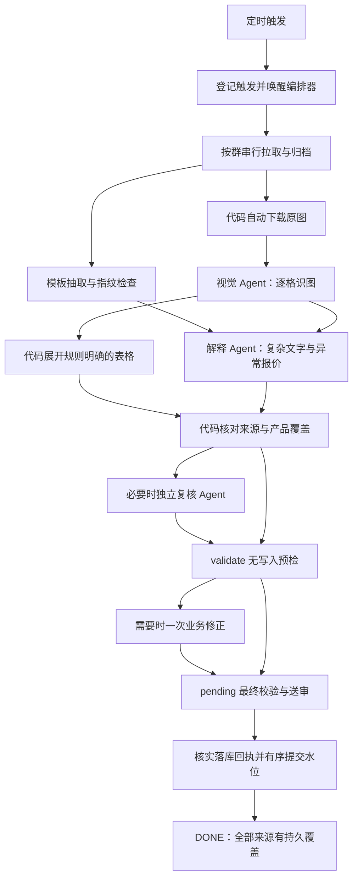

# 运价采集编排器设计

日期：2026-10-10；更新：2026-10-26。状态：基础链路已实现为常驻服务 0.11.1，隔离启停、队列执行、部分解析交付、补缺业务判重、Trace 全量消息展示和手动触发置顶已验证；Windows 计划任务不再属于目标调度方案。

## 1. 目标与当前事实

常驻服务内部调度器只负责按确定时间槽登记一次触发。编排器通过持久化任务队列推进拉取、原图下载、识图、报价解释、覆盖核查、预检、一次业务修正和送审。下一次触发不能覆盖、终止或重建上一轮。

当前源码核对：

- `pipeline.py` 有状态机、图片缺缓存队列、BUILD、预检、提交和水位逻辑，但 Agent 执行仍由外部会话接力。
- `paths.py` 用 MMDD 与分片组织目录，OCR 缓存共享；这不足以标识同日多轮和跨年运行。
- `ops/codex-heartbeat/multi_agent_pilot.py` 已有独立 Codex CLI 会话与 JSON schema 交接，属于离线试点，没有接入 DWS、pending 或水位。
- 试点文档记录 2026-10-07 真实调用遇到认证 401；本次未重验，不能当成当前认证结论或可用能力证明。
- Skill、台账契约和公共提示词仍存在待统一项：未结构化消息如何存证、柜型四档与三档、一次修正与循环。带价现舱分类已于 2026-10-22 明确为同源运价 + 舱位双入，金额只写运价。

多 Agent 本身不能保证不漏执行。保证来自持久任务、依赖条件、租约、输出校验和覆盖核查。下载、归一、校验、提交不需要 Agent。

## 2. 分工与流程

| 执行者 | 输入 | 输出 | 权限 |
|---|---|---|---|
| 代码拉取/下载 worker | 群、边界、真实消息/图片 ID | 完整拉取回执、原始消息、原图摘要 | DWS 读取，无报价写权限 |
| 视觉 Agent | 实际原图、来源定位、识图结构契约 | 行列、原始表头、价格单元格、脚注、空价/不清晰位置 | 只产生候选输出 |
| 解释 Agent | 原文、必要引用、合格 OCR、本群规范、主数据快照 | 中文字段候选、逐字段证据、疑点与参照 | 只产生候选输出 |
| 独立复核 Agent | 原文/原图、候选及覆盖差异 | 具体遗漏、错配、无依据字段 | 只读复核，不放行 |
| 代码校验/提交 worker | 冻结候选与证据清单 | validate/pending 回执、真实覆盖结果 | 现有受限接口；不写正式表 |

稳定文字模板和有明确表头的规整价卡走代码展开。视觉 Agent 不推断主数据；解释 Agent 处理未知缩写、引用语义、费用范围和柜型参照。复核 Agent 仅用于新图片、低可信结果或覆盖异常，不让每条普通文字都经过四轮模型调用。

独立复核必须能直接看到原图，不能只看视觉 Agent 的转述。对于新价卡，先独立产出来源清单，再看候选比较，减少共同漏读。复核不是人工审核，不能自动放行报价。

## 3. 运行隔离与调度

每次有效触发创建唯一 `run_id`，例如 `20261010T090000Z_A_<uuid>`。UUID 用标准库生成；日期、分片只用于展示。触发幂等键由服务、计划时间槽和分片组成，例如 `engine:20261019-090000:A`，重复投递返回原 run。

运行上下文包含 run_id、分片、群范围、触发来源、规范快照摘要、构建版本、主数据快照摘要和身份名单版本。每个 worker 启动独立进程，明确传递上下文，禁止修改全局环境变量来切换另一个 run。

不同轮解析可并行；同一群的拉取领取和水位提交必须有序。默认最多两项 Agent 工作并发，全局共用限额，A/B 不各自无限开进程。新增触发持久排队，不因资源满而丢弃，也不杀旧进程。

编排器作为独立常驻进程运行，由 `start-service` 脱离当前终端启动，并由 `stop-service` 优雅停止；不使用 Windows 计划任务、`schtasks` 或 Codex 自动化时钟。调度线程按 `config/schedule.json` 热读取规则并持久入队，Worker 执行线程不会因下一次触发被替换。进程重启后扫描租约和未完成任务，恢复原 run；不依赖当前对话或 Codex 任务会话持续存活。

## 4. 持久化与任务契约

第一阶段用标准库 SQLite 存运行控制状态，业务真源继续是台账 PostgreSQL。SQLite 放本机配置的运行目录，不能放网络共享；适配层允许后续替换，不提前引入 Redis/Celery 或第三方依赖。

建议控制表：

| 表 | 用途与关键约束 |
|---|---|
| triggers | 唯一 trigger_key；重复启动可追溯 |
| runs | 唯一 run_id；每轮快照、状态与计数；`priority` 区分手动置顶轮次与自动轮次 |
| sources | profile/org + 群 ID + 消息 ID + 来源修订摘要；不凭发送人姓名识别 |
| run_sources | 本轮与来源关联；重复来源复用持久结果 |
| tasks | task_id、run_id、来源、阶段、输入摘要、attempt、状态、lease_owner、lease_until、lease_generation |
| artifacts | 不可变产物路径、SHA256、schema_version、创建任务与 attempt |
| group_cursors | 已持久拉取边界、已送审边界、连续批次序号 |
| submissions | 冻结请求摘要、来源产品指纹、回执、提交不明状态 |
| events | 时间、级别、run/task/message 定位、状态变化及错误码；不记录凭据 |

任务状态：`QUEUED → RUNNING → SUCCEEDED`；故障可进入 `RETRY_WAIT`，实际尝试耗尽后为 `FAILED`。从未调用不算 FAILED，schema 不合格不算 SUCCEEDED。

自动触发对同群未开始的轮次执行合并；手动“立即解析”复用同群最早的未开始轮次并设置 `priority=1`，Worker 按 `priority DESC, run_id插入顺序, task position` 领取。优先级不能突破同群保序、同 lane 串行、并发上限或前置任务依赖。

所有命令返回 `{ok,data?,error?}`。Agent 输出交接封套至少含 schema_version、run_id、task_id、attempt、lease_generation、input_digest、artifact_digest 和 stage-specific result。产物用临时文件原子发布，由编排器核验和登记；Agent 不自行修改控制表或 run 状态。

输出只在 task_id、输入摘要、当前 attempt 与租约代次一致时接受。旧 worker 即使迟到，输出也只能归档为过期结果，不能覆盖新 attempt。真正的进程/凭据权限隔离须单独验证；独立上下文不等于文件读取隔离。

## 5. 图片阶段：不再允许未执行被算完成

每个真实 mediaId 创建下载依赖；下载结果包括消息验证、原图文件路径、非零字节数与 SHA256。引用图片带原消息归属，不擅自当成新的报价。

视觉任务开始前检查原图实际可读。成功输出必须符合已有图片结构契约，包含：

- 图片原始表头与行列定位。
- 可报价行、价格单元格、柜型列、币种、日期及其含义。
- 空白/停报/划掉/不可读单元格及原因。
- 脚注与费用适用范围；不得把附加费当基础海运价。
- 来源清单，供后续按行、港口、服务、柜型、价格和有效期逐项对账。

代码检查的不只是行数和数字集合。例如两个港口价格相同仍是两个来源项目；D4/D5 同价合并时保留两个单元格映射；异价不强行合并。非美元按既有“见原图”占位契约处理，原币种金额保留证据，禁止换算成 USD。

BUILD 前发现未执行/过期/损坏的视觉产物，自动领取或重建视觉任务。禁止直接跳到 evidence-only。下载或解析真实失败才进入有原因的失败路径；其他消息继续推进。

共享 OCR 缓存用 profile/org、mediaId、图片字节摘要、识图契约/解析版本标识。缓存不可被另一轮直接覆盖；更正生成新 revision。原始识图可复用，群规则解释和有效期推导属于消息级，不跨来源复用结论。

## 6. 重试、失败与 DONE 含义

网络超时、下载服务繁忙、worker 崩溃：最多三次总尝试，退避排队，不阻塞编排器长时间睡眠。认证/权限失败标明确原因，不能伪装网络故障。建议任务租约 300 秒、每 30 秒续租；worker 超时和输出大小另设命名常量，按实测调整。全部时间配置使用 `_seconds` 后缀。

模型调用/输出格式失败属于执行重试；业务校验失败只允许既有的一轮业务修正。首次 validate 后生成修正任务，修正后直接交 pending 最终校验，不反复调用模型凑通过率。coverage/audit/normalize 等业务阶段仍未闭合时，代码把已识别且可转换的产品逐条送 pending 并读回，同时 upsert review issue；元数据明确标记部分解析、失败阶段、已完成阶段、排除候选和人工问题。一个产品都无法形成时仍写可见待核。待审读回和待核回执确认后，消息进入 `PARTIAL_REVIEW_COMPLETE`，下游完整阶段软跳过，父批次可正常 reconcile/watermark；该终态不证明完整解析，也不能自动放行。

所有已拉取消息必须自动持久收录。未结构化来源保存原文、图片引用、失败任务/attempt、实际失败原因和可核实字段；初期沿用现有 pending 证据行与 review-issues，不把“未执行”当失败收尾。图片引用也必须写入证据行，避免原图不可见。

run 只有在所有来源都有台账持久覆盖、每项任务有合法结案回执、送审回执已核实时才能 DONE。DONE 表示全部来源已收录，不保证报价全部通过。摘要必须分别列结构化条目、failed 条目、真实下载/解析失败和未执行数；DONE 的未执行数必须为零。纯噪声/身份不明确按既有规则存证，不生成虚假业务事实。

认证失效、台账不可达等外部故障可导致明确的可恢复阻断：保存状态、报警并自动继续重试，不能为了显示 DONE 伪造成功或推进未送审水位。这是全自动运行的故障边界，不是等待用户继续的普通阶段。

## 7. 水位、去重与提交不明

区分两条边界：

- 拉取边界：分页完整且原始回包、来源清单在本地事务/归档中持久保存后推进，用于后轮发现新消息；不是现行业务水位。
- 送审边界：台账真实覆盖确认后推进现行水位；按同群连续批次顺序提交。

例：A1 拉到 09:00，A2 拉到 10:00；A2 先送审完成，只登记完成，不越过尚未完成的 A1 推进送审水位。A1 补完后再连续推进至 10:00。故障恢复优先处理已归档来源，不能只从拉取边界继续导致旧来源遗失。拉取边界的切换须先验证运行库恢复和原始文件归档可靠性。

DWS 未保证快照分页时，使用已验证的时间/游标语义和配置化回看区间，按消息身份及来源修订摘要去重；不得假设存在尚未核实的 upper-bound 参数。未完整分页不提交拉取边界。

run_id 是执行身份，不是报价身份。产品去重仍使用现有来源、港口、柜型、服务、船期、有效期和价格等业务指纹；不同价格/船期不能因为同一消息被误合并。不得声称现有数据库已有任意新幂等约束。

提交前冻结请求并持久保存摘要。HTTP 超时进入 SUBMIT_UNKNOWN，先分页查询同源实际行并核对完整产品指纹；已存在的保留，缺项走 submit_missing。不得无条件整组重提撤换原 id/edit_log，不覆盖人工修改。实施时核实并补足服务端指纹/事务保障再验收。

## 8. 目录与渐进接入

建议新增在现有 Skill scripts 下的 `freight_orchestration/`：

- `core/`：零外部依赖的常量、数据类型、schema_version 和状态契约。
- `services/`：零 IO 的依赖规划、覆盖比较、重试决策、租约结果验收。
- `transport/`：SQLite 仓储、DWS 子进程、Codex CLI 适配、HTTP 客户端、文件归档和进程监督。
- CLI 入口：enqueue、worker、status、resume；通过结构化参数调用，不拼 shell 文本。

运行目录：`runs/<run_id>/source|tasks|artifacts|receipts`；共享原图和识图结果位于独立不可变 artifact 区。现有 MMDD 目录仅通过迁移适配读取，不能让新 run 复用旧可写目录。

复用 record_builder、日期解析、Master 识别、check_llm_out、validate/pending/submit_missing；逐步收敛 pipeline.py 为兼容入口，避免重写业务解析。复用离线试点的 CLI 调用思路，补生产任务契约；不会原样上线试点脚本。

上线顺序：

1. 建任务契约、租约与控制存储，离线验证多轮并发、崩溃恢复和迟到输出。
2. 在实际计划任务账户下验证现有 CLI 的文字、真实图片输入、schema 输出和认证；记录成本、时延和超时。当前尚未验证。
3. 用本次 ONE 图及其他已纠错来源做只读回放，逐格对账；不产生重复待审行。
4. 接入单个群的小范围试运行，保留现有送审边界和回执；切换时按群租约排除旧新双采。
5. 扩大到 A/B；定时任务改为 enqueue，独立进程承担 worker 与恢复。

先写接口/类型，再实现；新增模块和配置时更新架构基底，接口变化更新契约，实际版本变更按 SemVer 记录。设计草案本身不宣称代码已经实现，不提前修改运行版本。

## 9. 必须通过的验收场景

| 场景 | 验收结果 |
|---|---|
| 同一计划触发两次 | 只登记一轮，不重复拉取/送审 |
| 新轮开始时旧轮仍识图 | 旧轮继续运行，目录/状态/输出互不覆盖 |
| worker 无输出便退出 | 重试原任务；未执行不能变成普通空占位 DONE |
| 视觉超时后迟到输出 | 拒绝旧代次结果，不污染新结果 |
| 原图下载失败 | 保存真实失败回执与来源，其余消息继续 |
| 图片价格清楚，文字只有费用说明 | 原图基础价全部保留，费用在备注 |
| ONE 本次价卡 | 23 个有价目的地、50 条规范柜型报价；Point Lisas 空价不造记录；逐格验证合并和价格 |
| 价格相同、港口不同/船期不同 | 分别覆盖，数字集合相等不能掩盖漏行 |
| 修正后仍不通过 | failed/awaiting，业务修正不循环、不自动放行 |
| 提交成功但客户端超时 | 核实实际行后仅补缺，不撤换原编号和编辑日志 |
| 后轮先完成 | 送审水位不跨过前轮缺口 |
| 进程重启、机器重启 | 从持久任务和租约恢复，不重新生成 new_ids |
| 台账持续不可达 | 明确未送审与故障原因，水位保持，不报 DONE |

建议优先实现“任务队列 + 图片回执门禁 + 多轮隔离 + 提交恢复”，随后接视觉与解释 worker。无需为素材下载、数据库校验、定时触发各开一个模型 Agent。
